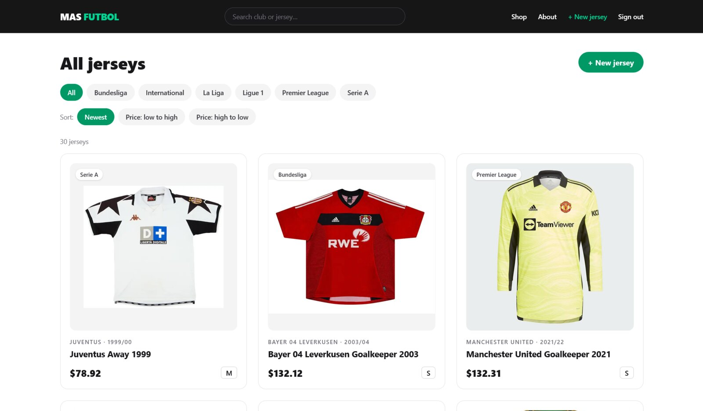
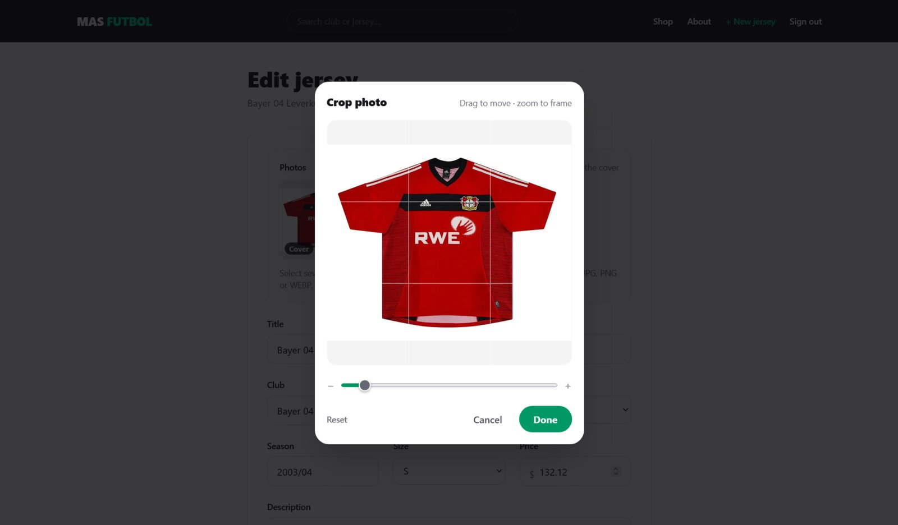
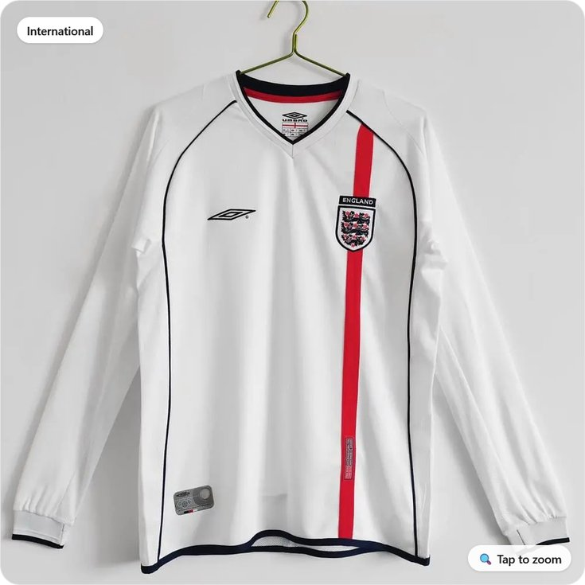
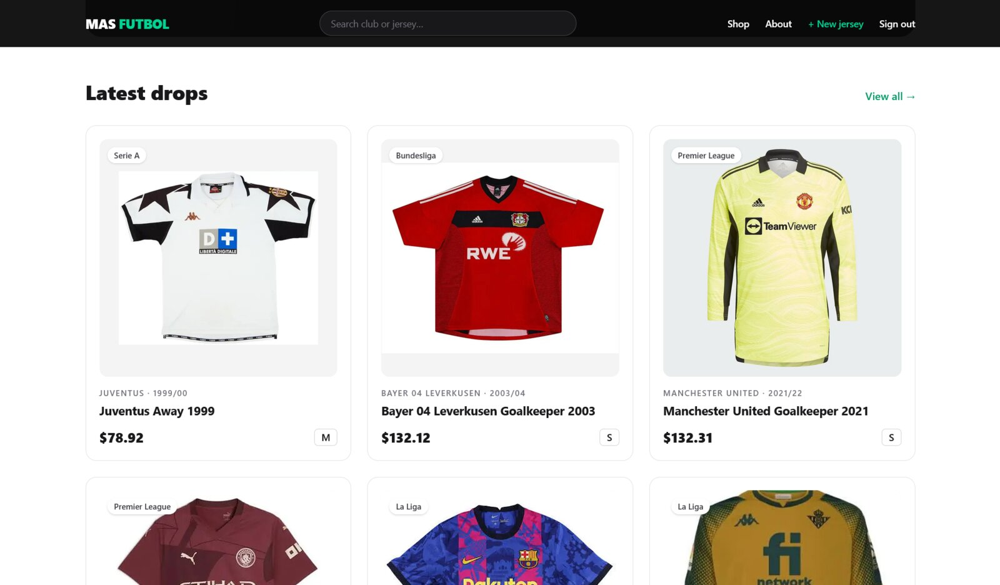

# Mas Futbol Drops

An online storefront for **Mas Futbol**, my retro and replica football jersey resale business, built with Ruby on Rails 8.

Shoppers can browse kits by league, search, sort by price, inspect every detail of a jersey up close, and check out with Stripe. On the admin side I can list a jersey Depop-style: drop in a batch of photos, frame each one with a crop editor, and publish.

**Live demo: [mas-futbol-drops.onrender.com](https://mas-futbol-drops.onrender.com)**  
<sub>Hosted on a free plan, so the first visit after a quiet spell can take about a minute to wake up.</sub>



## Features

### For shoppers

- **Browse and filter**: filter by league (Premier League, La Liga, Serie A…), search by club or title, and sort by newest or price. League filters, search and sort combine, and your sort is kept as you switch leagues.
- **Product pages** with a photo gallery and clickable thumbnails.
- **Zoom viewer**: click any photo to open it fullscreen in full resolution, then click again to zoom 2.5× wherever you point, so buyers can check badges, tags and stitching before they buy. It supports arrow keys, Esc, and touch.
- **Stripe Checkout** for secure payments.
- **Readable URLs** like `/jerseys/juventus-away-1999`, via FriendlyId.

### For the admin

- **Sign in** with email and password, Google, or GitHub (Devise + OmniAuth). Accounts are linked by email, public sign-up is disabled, and only admins see the management tools.
- **Multi-photo upload, like listing on Depop**: select several photos at once or drag a batch in from a folder. Previews appear instantly, each pick adds to the photos already chosen, any photo can be removed before saving, and the first photo is the cover. Up to 8 photos per jersey, validated on both client and server.
- **Non-destructive crop editor**: drag to reposition and zoom in or out with a slider or scroll wheel. Only the framing is saved, so the original upload is never altered and can be re-cropped at any time.

<p>
  
  
</p>

## How the photo cropping works

The crop editor never changes the uploaded file. Each photo's framing is stored as a center point and a zoom level:

```ruby
# jerseys.photo_crops (jsonb), keyed by Active Storage blob id
{ "12" => { "x" => 0.5, "y" => 0.42, "zoom" => 1.3 } }
```

- **Display:** `Jersey.crop_box` turns that into the photo's position and size inside a square frame, as CSS percentages. The same math runs in the Stimulus editor for the live preview, so what the admin sees while cropping is exactly what shoppers see.
- **Image variants:** variants only *shrink* photos (`resize_to_limit`) and never crop them, so one set of variants serves every possible crop.
- **Zoom viewer:** shoppers zoom into a separate 2400px variant of the *uncropped* photo, so nothing the seller framed out is hidden from a buyer who wants to look closely.

## Tech stack

| | |
| --- | --- |
| Framework | Ruby on Rails 8.1, Ruby 4.0 |
| Database | PostgreSQL |
| Frontend | Hotwire (Turbo + Stimulus), Tailwind CSS v4, Import Maps |
| Images | Active Storage with libvips (WebP variants) |
| Auth | Devise, OmniAuth (Google, GitHub) |
| Payments | Stripe Checkout |
| Other | FriendlyId, Faker seed data, Minitest, Solid Queue |

## Getting started

**Requirements:** Ruby 4.0.9, PostgreSQL, and libvips for image processing.

```bash
# macOS
brew install vips
# Ubuntu / WSL
sudo apt install libvips-tools
```

**Set up and run:**

```bash
git clone https://github.com/davidavitavi/mas_futbol_drops.git
cd mas_futbol_drops
bin/setup --skip-server   # installs gems, creates the database, loads sample data
bin/dev                   # http://localhost:3000
```

The sample data includes an admin account, `admin@masfutbol.com`, with its password taken from `ADMIN_PASSWORD` (default `changeme123`), plus 30 jerseys. Note that `bin/rails db:seed` deletes all existing jerseys before re-seeding.

**API keys** (optional for browsing, needed for checkout and social sign-in) live in Rails credentials. Edit them with `bin/rails credentials:edit`:

```yaml
stripe:
  secret_key: sk_test_...
google:
  client_id: ...
  client_secret: ...
github:
  client_id: ...
  client_secret: ...
```

## Deployment

The live site runs entirely on free tiers:

| | Service | Why |
| --- | --- | --- |
| Web app | [Render](https://render.com) (free, Docker) | Builds from the repo's `Dockerfile` using [`render.yaml`](render.yaml) |
| Database | [Neon](https://neon.com) Postgres (free) | No expiry; one database via `DATABASE_URL` |
| Photos | [Cloudflare R2](https://www.cloudflare.com/developer-platform/products/r2/) (free) | Render's disk is wiped on every deploy |

Production keeps the moving parts small for a single free server: caching, background jobs and Action Cable run in memory instead of in Solid Cache/Queue/Cable databases. On each start, the Docker entrypoint runs `db:prepare`, which migrates the database. On a brand-new database it also seeds the admin account and leagues; the admin password comes from `ADMIN_PASSWORD`, and no demo data is created.

Environment variables set in Render: `RAILS_MASTER_KEY`, `DATABASE_URL`, `ADMIN_PASSWORD`, `R2_ACCOUNT_ID`, `R2_ACCESS_KEY_ID`, `R2_SECRET_ACCESS_KEY` and `R2_BUCKET`. The live site also has its own GitHub OAuth app, whose keys are set as `GITHUB_CLIENT_ID` and `GITHUB_CLIENT_SECRET`. These override the credentials file, and `GOOGLE_CLIENT_ID` / `GOOGLE_CLIENT_SECRET` work the same way if ever needed.

> Free Render services sleep after 15 minutes without traffic, so the first visit after a quiet period takes about a minute to load.

## Tests

```bash
bin/rails test
```

<details>
<summary>More screenshots</summary>



</details>
